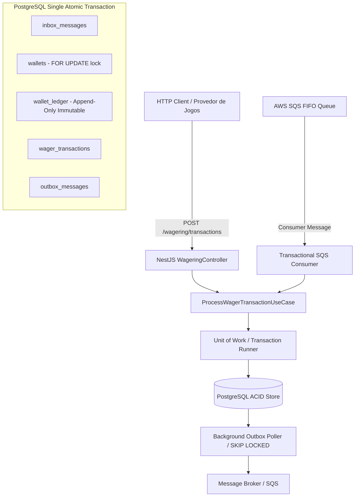

# Decisões de Arquitetura e Especificação Técnica (ARCHITECTURE.md)

Este documento descreve detalhadamente as escolhas arquiteturais, padrões adotados, modelo de consistência e justificativas de trade-offs implementados no processador de apostas distribuído.

---

## 1. Visão Geral da Arquitetura

O sistema é desenhado seguindo os princípios de **Domain-Driven Design (DDD)** puro na camada de domínio, arquitetura hexagonal / ports & adapters, com banco de dados **PostgreSQL** para consistência transacional ACID estrita e **AWS SQS** para transporte assíncrono.

---

## 2. Princípios de Consistência e Concorrência

1. **Precisão Financeira Sem Ponto Flutuante (`Money` Value Object):**
   - Nenhum tipo primitivo `number` é utilizado para cálculos financeiros.
   - Toda aritmética é mediada pela biblioteca de precisão arbitrária `decimal.js`, encapsulada no Value Object imutável `Money`.
   - Serialização com escala fixa de 2 casas decimais (`"25.00"`), rejeitando valores com mais de 2 casas, notação científica, `NaN` e moedas divergentes.

2. **Idempotência Persistente e Hash Canônico:**
   - A idempotência é garantida no banco de dados por `idempotency_key` única e pelo hash SHA-256 canônico com ordenação recursiva de chaves de payload (`computeCanonicalPayloadHash`).
   - **Replay vs Conflito:** Reenviar a mesma chave com payload idêntico retorna `200 OK` (ou `202 Accepted`) com o resultado original e o **saldo histórico observado naquele momento** (`idempotentReplay: true`), sem reexecução contábil. Reenviar a mesma chave com payload diferente dispara `409 Conflict`.

3. **Consistência Sem Confiança Cega em Filas FIFO:**
   - O SQS FIFO atua como camada de transporte de alta disponibilidade. A deduplicação real e a idempotência são executadas no PostgreSQL via padrão **Transactional Inbox** com chave composta `(consumer_name, message_id)`.

4. **Publicação de Eventos Estritamente Pós-Commit (Transactional Outbox):**
   - Nenhum evento é disparado diretamente para a rede antes da confirmação da transação SQL.
   - Os eventos são gravados na tabela `outbox_messages` dentro da mesma transação SQL que altera o saldo e grava o ledger. Um worker em segundo plano lê com `SELECT ... FOR UPDATE SKIP LOCKED` e publica de forma assíncrona com retries e backoff exponencial.

5. **Imutabilidade Contábil do Ledger:**
   - O `WalletLedgerEntry` é puramente append-only.
   - No banco de dados, além do código da aplicação, uma trigger PostgreSQL (`trg_prevent_ledger_modification`) intercepta qualquer comando `UPDATE` ou `DELETE` na tabela `wallet_ledger`, lançando uma exceção no nível do motor relacional.

6. **Controle de Concorrência e Isolamento por Carteira (`walletId`):**
   - Não existe lock global em nível de tabela.
   - A concorrência é serializada atomicamente no registro da carteira usando `SELECT ... FOR UPDATE` no `walletId`.
   - Wallets distintas processam em paralelo com máxima vazão, enquanto requisições concorrentes na mesma carteira (cenário de _Hot Wallet_) são processadas sequencialmente sem perdas de atualização (_lost updates_).

7. **Invariantes em Banco de Dados (DDL):**
   - Saldo não negativo garantido por `CHECK (balance >= 0)`.
   - Unicidade de carteira por jogador e moeda garantida por `UNIQUE (player_id, currency)`.
   - Garantia de estorno único no banco via `CREATE UNIQUE INDEX ... WHERE kind IN ('REFUND', 'ROLLBACK') AND status = 'PROCESSED'`.
   - Integridade referencial com chaves estrangeiras.

8. **Execução em Múltiplas Instâncias ($\ge 3$):**
   - Todo o estado mutável e locks residem exclusivamente no PostgreSQL. Múltiplas instâncias do NestJS ou múltiplos consumers SQS operam simultaneamente sem race conditions nem corrupção de dados.

9. **Invariante Contábil Auditável:**
   - O saldo materializado na tabela `wallets` é estritamente igual à soma algébrica dos lançamentos de débito e crédito no `wallet_ledger`, validado continuamente pelo caso de uso `ReconcileWalletUseCase` (`difference: 0.00`).

---

## 3. Decisão de Persistência e Padrão Unit of Work (Justificativa de ORM)

A Seção 4 da especificação aceita **MikroORM** (preferencial) ou **TypeORM** com foco explícito no padrão **Unit of Work**, demarcação transacional (`EntityManager.transactional()`), controle de locking (`LockMode.PESSIMISTIC_WRITE`) e proteção da modelagem de domínio contra tipos de framework.

### 3.1 Padrão Unit of Work e Semântica Transacional

Nossa arquitetura implementa formalmente o padrão Unit of Work através das portas `ITransactionRunner` e `IUnitOfWork`:

- **Isolamento de Transação:** Toda operação de aposta, débito/crédito de carteira, inserção de ledger, deduplicação de inbox e enfileiramento de outbox ocorre sob uma única sessão transacional ACID (`BEGIN ... COMMIT / ROLLBACK`).
- **Bloqueio Pessimista (`FOR UPDATE`):** O método `uow.wallets.findByIdForUpdate(id)` espelha o `LockMode.PESSIMISTIC_WRITE` do MikroORM, garantindo serialização estrita na carteira sem afetar outras contas.
- **Padrão Repository & Identity Management:** Repositórios segregados recebem o executor transacional da Unit of Work, impedindo vazamento de conexões ou transações parciais.

### 3.2 Mapeamento de `Money` e Isolamento do Domínio

- O Value Object `Money` é modelado sem qualquer decorator de ORM (`@Column`, `@Entity`) para preservar o encapsulamento e a portabilidade de DDD puro.
- Na persistência relacional, o valor é armazenado na coluna exata `NUMERIC(18, 2)` e a moeda na coluna `VARCHAR(3)`, sendo reconstituído exclusivamente via factory estática `Money.from({ amount, currency })` com biblioteca de precisão arbitrária `decimal.js`.

---

## 4. Decisão Arquitetural: Autenticação e Pontos de Extensão

A Seção 2 estabelece que autenticação não pontua e não deve competir com correção contábil, recomendando delegar a um IdP externo (Keycloak, Zitadel, AWS Cognito ou API Gateway perimetral).

### 4.1 Ponto de Extensão no Código

Para manter os pontos de extensão explícitos e desacoplados, implementamos:

- **Porta de Identidade:** `IProviderIdentityPort` (`src/application/ports/provider-identity.port.ts`), definindo os contratos de autenticação de tokens e validação de escopos de provedores.
- **Guard Não-Bloqueante:** `NoOpAuthGuard` (`src/infrastructure/http/guards/noop-auth.guard.ts`), aplicado nos controllers protegidos (`WalletsController`, `WageringController`, `ProvidersController`). Em ambientes de produção corporativa, esse guard é substituído pela validação JWT/OIDC contra o IdP sem qualquer alteração na camada de negócios.
- **Health Checks Abertos:** Os endpoints `/health/live` e `/health/ready` não exigem autenticação, conforme solicitado.

---

## 5. Referências Fora de Ordem e Política de Expiração (TTL / Backoff)

Operações `REFUND` ou `ROLLBACK` recebidas antes da transação original entram no estado **`PENDING_REFERENCE`** (HTTP `202 Accepted`).

1. **Reconciliação:** O `PendingReferenceReconciler` busca lotes de transações pendentes e tenta resolver a referência.
2. **Limite de Tentativas / TTL:** A transação possui o contador `pending_attempts`. Cada ciclo sem a chegada da transação referenciada incrementa o contador.
3. **Rejeição por Timeout:** Ao atingir o limite estipulado (padrão: 5 tentativas com backoff), a transação é transicionada para **`REJECTED`** com o código legível `MISSING_REFERENCE_TIMEOUT`, gerando o respectivo evento `WagerTransactionRejected` na Outbox para notificação do provedor.

---

## 6. Observabilidade e Telemetria

O serviço expõe métricas em formato padrão Prometheus no endpoint `GET /metrics` (`PrometheusService`):

- `jg_wagering_transactions_total`: Contagem de transações por `status`, `kind` e `providerId`.
- `jg_wagering_idempotent_replays_total`: Replays idempotentes detectados.
- `jg_wagering_transaction_duration_seconds`: Histograma de latência com buckets específicos.
- `jg_retries_total`: Contagem de retries automáticos decorrentes de contenção transitória.
- `jg_dlq_messages_total`: Mensagens encaminhadas para a DLQ.
- `jg_lock_conflicts_total`: Conflitos e esperas de lock concorrentes.
- `jg_outbox_lag`: Gauge indicando o backlog de eventos pendentes na tabela Outbox.
- `jg_outbox_messages_published_total`: Eventos despachados com sucesso.
- `jg_wallet_reconciliations_total`: Auditorias de reconciliação contábil realizadas.

Os logs da aplicação utilizam formato estruturado JSON (`StructuredLogger`), com sanitização automática de credenciais, URLs sensíveis e senhas.

---

## 7. Migrations Versionadas e Reversíveis

O esquema relacional é mantido através de scripts SQL versionados e reversíveis:

- `migrations/001_initial_schema.sql`: Criação de tabelas, índices parciais exclusivos, constraints `CHECK` e trigger PL/pgSQL de imutabilidade do ledger.
- `migrations/001_initial_schema.down.sql`: Script de reversão completa (drop seguro de triggers, índices e tabelas).
