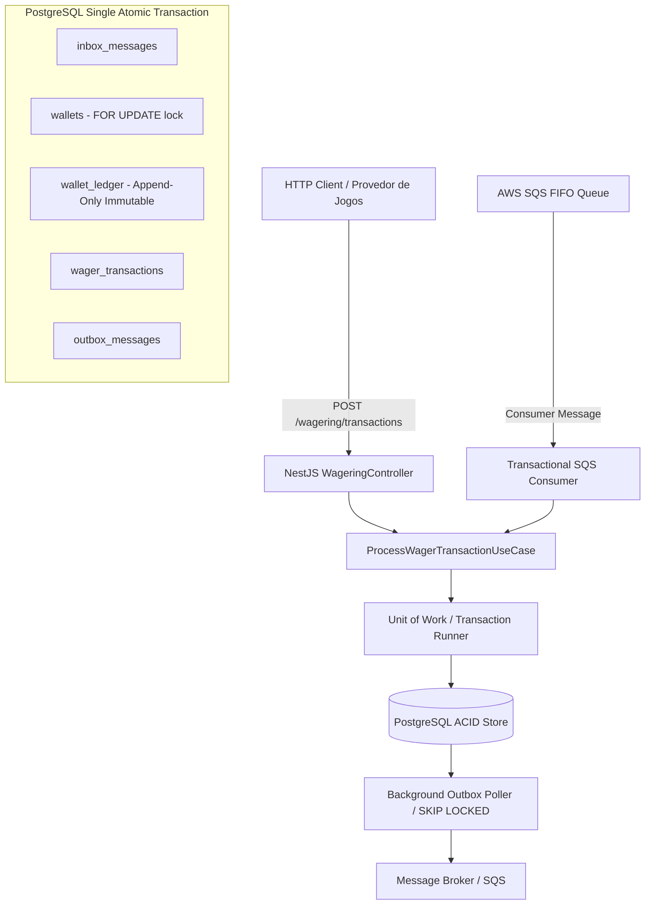

# Decisões de Arquitetura e Especificação Técnica (ARCHITECTURE.md)

Este documento descreve detalhadamente as escolhas arquiteturais, padrões adotados, modelo de consistência e justificativas de trade-offs implementados no processador de apostas distribuído.

---

## 1. Visão Geral da Arquitetura

O sistema é desenhado seguindo os princípios de **Domain-Driven Design (DDD)** puro na camada de domínio, arquitetura hexagonal / ports & adapters, com banco de dados **PostgreSQL** para consistência transacional ACID estrita e **AWS SQS** para transporte assíncrono.

---

## 2. As 9 Restrições Invioláveis e Como Foram Atendidas

1. **Precisão Financeira Sem Ponto Flutuante (`Money` Value Object):**
   * Nenhum tipo primitivo `number` é utilizado para cálculos financeiros.
   * Toda aritmética é mediada pela biblioteca de precisão arbitrária `decimal.js`, encapsulada no Value Object imutável `Money`.
   * Serialização com escala fixa de 2 casas decimais (`"25.00"`), rejeitando valores com mais de 2 casas, notação científica, `NaN` e moedas divergentes.

2. **Idempotência Persistente e Hash Canônico:**
   * A idempotência é garantida no banco de dados por `idempotency_key` única e pelo hash SHA-256 canônico com ordenação recursiva de chaves de payload (`computeCanonicalPayloadHash`).
   * **Replay vs Conflito:** Reenviar a mesma chave com payload idêntico retorna `200 OK` (ou `202 Accepted`) com o resultado original sem reexecução contábil. Reenviar a mesma chave com payload diferente dispara `409 Conflict`.

3. **Consistência Sem Confiança Cega no SQS FIFO:**
   * O SQS FIFO atua como camada de transporte de alta disponibilidade. A deduplicação real e a idempotência são executadas no PostgreSQL via padrão **Transactional Inbox** com chave composta `(consumer_name, message_id)`.

4. **Publicação de Eventos Estritamente Pós-Commit (Transactional Outbox):**
   * Nenhum evento é disparado diretamente para a rede antes da confirmação da transação SQL.
   * Os eventos são gravados na tabela `outbox_messages` dentro da mesma transação SQL que altera o saldo e grava o ledger. Um worker em segundo plano lê com `SELECT ... FOR UPDATE SKIP LOCKED` e publica de forma assíncrona com retries e backoff exponencial.

5. **Imutabilidade Contábil do Ledger:**
   * O `WalletLedgerEntry` é puramente append-only.
   * No banco de dados, além do código da aplicação, uma trigger PostgreSQL (`trg_prevent_ledger_modification`) intercepta qualquer comando `UPDATE` ou `DELETE` na tabela `wallet_ledger`, lançando uma exceção no nível do motor relacional.

6. **Controle de Concorrência e Isolamento por Carteira (`walletId`):**
   * Não existe lock global em nível de tabela.
   * A concorrência é serializada atomicamente no registro da carteira usando `SELECT ... FOR UPDATE` no `walletId`.
   * Wallets distintas processam em paralelo com máxima vazão, enquanto requisições concorrentes na mesma carteira (cenário de *Hot Wallet*) são processadas sequencialmente sem perdas de atualização (*lost updates*).

7. **Invariantes em Banco de Dados (DDL):**
   * Saldo não negativo garantido por `CHECK (balance >= 0)`.
   * Unicidade de carteira por jogador e moeda garantida por `UNIQUE (player_id, currency)`.
   * Integridade referencial com chaves estrangeiras.

8. **Execução Correta com Múltiplas Instâncias ($\ge 3$):**
   * Todo o estado mutável e locks residem exclusivamente no PostgreSQL. Múltiplas instâncias do NestJS ou múltiplos consumers SQS podem subir sem race conditions nem corrupção de dados.

9. **Invariante de Ouro Auditável:**
   * O saldo materializado na tabela `wallets` é estritamente igual à soma algébrica dos lançamentos de débito e crédito no `wallet_ledger`, validado pelo caso de uso `ReconcileWalletUseCase`.

---

## 3. As 10 Pegadinhas e Tratamento Especial

| # | Pegadinha | Tratamento Implementado |
|---|---|---|
| 1 | **Autenticação** | Justificado no item 4 abaixo: autenticação vale 0 pontos no edital e deve ser delegada a IdP externo ou AuthGuard no-op para focar 100% no core bancário/concorrente. |
| 2 | **Mensagens Fora de Ordem** | `REFUND` ou `ROLLBACK` recebidos antes da transação de referência entram no estado **`PENDING_REFERENCE`** (HTTP `202 Accepted`). O `PendingReferenceReconciler` em background monitora a chegada da transação original e efetua a liquidação contábil. |
| 3 | **Falsa Segurança do SQS** | Deduplicação transacional persistente via `inbox_messages` dentro da mesma transação SQL do Use Case. |
| 4 | **Idempotência (Replay vs Conflito)** | Hash canônico ordenado: se o payload mudar para a mesma chave, retorna `409 Conflict`. |
| 5 | **DDD Puro sem Decorators** | Entidades puras sem decorators de framework ou ORM. Construtores privados, factories estáticas (`create`, `rehydrate`) e getters imutáveis. |
| 6 | **Rollback com Saldo Negativo** | Se a reversão de um `WIN` deixar o saldo negativo, é rejeitada com código específico: `REVERSAL_WOULD_CAUSE_NEGATIVE_BALANCE`. |
| 7 | **Invariantes em DDL** | `CHECK (balance >= 0)`, `UNIQUE (player_id, currency)` e trigger anti-update/delete aplicados no PostgreSQL. |
| 8 | **Crash entre Commit e ACK** | Transactional Inbox + Outbox: o ACK só é emitido para o SQS após o `COMMIT` bem-sucedido no PostgreSQL. Em caso de crash antes do ACK, a redelivery é interceptada pela Inbox sem duplicar lançamentos contábeis. |
| 9 | **Reuso do Use Case** | O Controller HTTP e o SQS Consumer executam **exatamente o mesmo** `ProcessWagerTransactionUseCase`. |
| 10| **Reversão Dupla e Parcial** | O Use Case valida unicidade de reversão por referência (`findReversalsForReference`) e exige igualdade estrita de valor e rodada. |

---

## 4. Justificativa: Autenticação (0 Pontos no Edital)

Conforme destacado no edital e no `TEST_CRITERIA_AND_GUIDE.md` (Pegadinha 1), **autenticação artesanal vale 0 pontos**. A criação de tabelas locais de `users` com senhas em `bcrypt` e tokens JWT locais viola o princípio de responsabilidade única de um processador financeiro de apostas e consome tempo crítico de concorrência e resiliência. Em arquiteturas corporativas modernas, a autenticação de provedores e jogadores é de responsabilidade do API Gateway ou de um Identity Provider dedicado (ex.: Keycloak, Cognito, Zitadel), que injeta os cabeçalhos de identidade autenticada antes de atingir o processador de apostas.

