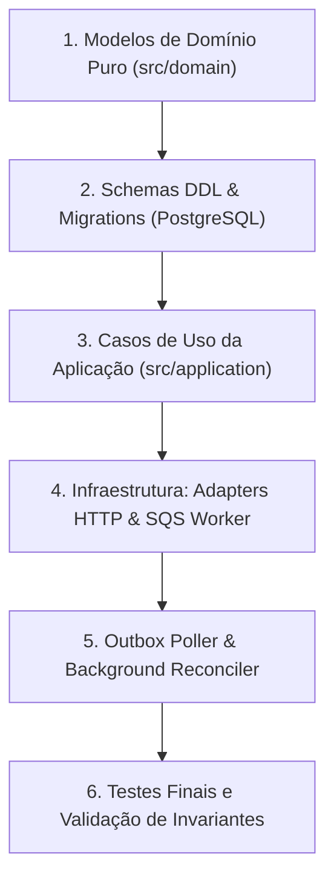

# Master Specification & Implementation Guide
**Projeto:** Distributed Wagering Processor (`junglegaming/backend-challenge`)  
**Runtime:** Bun 1.x | **Linguagem:** TypeScript (strict) | **Framework:** NestJS | **Banco:** PostgreSQL | **Mensageria:** AWS SQS (LocalStack)

> Este documento é o **guia definitivo e autossuficiente** do projeto. Ele reúne **absolutamente tudo** o que foi discutido e analisado: todas as regras de negócio, as 10 pegadinhas, a stack e o que é proibido, os contratos de API e SQS, o modelo de domínio completo, as 9 restrições invioláveis, a tabela de pontuação (100 pontos), as falhas eliminatórias e o mapeamento detalhado da estrutura de testes.

---

## Sumário
1. [Stack Tecnológica e Ferramentas Proibidas](#1-stack-tecnológica-e-ferramentas-proibidas)
2. [As 9 Restrições Invioláveis e Falhas Eliminatórias](#2-as-9-restrições-invioláveis-e-falhas-eliminatórias)
3. [As 10 Pegadinhas e Armadilhas do Desafio](#3-as-10-pegadinhas-e-armadilhas-do-desafio)
4. [Tabela de Avaliação (100 Pontos)](#4-tabela-de-avaliação-100-pontos)
5. [Modelo de Domínio Rico (DDD) e Esqueletos de Referência](#5-modelo-de-domínio-rico-ddd-e-esqueletos-de-referência)
6. [Regras de Negócio e Máquina de Estados](#6-regras-de-negócio-e-máquina-de-estados)
7. [Contratos de API HTTP e Tratamento Semântico de Erros](#7-contratos-de-api-http-e-tratamento-semântico-de-erros)
8. [Mensageria SQS, Transactional Inbox e Outbox](#8-mensageria-sqs-transactional-inbox-e-outbox)
9. [Observabilidade, Logs e Métricas](#9-observabilidade-logs-e-métricas)
10. [Mapeamento Completo da Estrutura de Testes (TDD)](#10-mapeamento-completo-da-estrutura-de-testes-tdd)
11. [Roteiro de Implementação Passo a Passo](#11-roteiro-de-implementação-passo-a-passo)

---

## 1. Stack Tecnológica e Ferramentas Proibidas

### Obrigatória
* **Runtime / Package Manager / Test Runner:** **Bun 1.x** (comandos: `bun add`, `bun test`, `bun run`).
* **Linguagem:** **TypeScript** em modo estrito (`"strict": true` no `tsconfig.json`).
* **Framework:** **NestJS**.
* **Banco de Dados Relacional:** **PostgreSQL** com migrations versionadas e reversíveis.
* **Mensageria:** **AWS SQS** rodando localmente via **LocalStack** ou **MiniStack** (filas FIFO: `wager-transactions.fifo` e `wager-transactions-dlq.fifo`).
* **Orquestração Local:** **Docker Compose**.
* **ORM:** **MikroORM** (preferencial da banca — possui *Unit of Work*, *Identity Map* explícito, `EntityManager.transactional()` e controle direto de `LockMode`) ou **TypeORM** (aceito).
* **Precisão Numérica:** Biblioteca de precisão arbitrária (ex.: **`decimal.js`**).

### ❌ Expressamente Proibido / Fora de Escopo
* **Prisma ORM** e outros ORMs não listados estão fora de escopo.
* **`number`, `float` ou `double`** do JavaScript para dinheiro.
* **Autenticação artesanal** (tabela de usuários com hash de senha `bcrypt`).
* **Bancos NoSQL / Redis como banco principal**.
* **Mocks de PostgreSQL ou SQS** nos testes de integração e concorrência.
* **Decorators de ORM ou NestJS dentro das classes de domínio puro** (o mapeamento é via `EntitySchema` na infraestrutura).

---

## 2. As 9 Restrições Invioláveis e Falhas Eliminatórias

### As 9 Restrições Invioláveis (Seção 5)
1. **Não usar `number`, `float` ou `double` para dinheiro.**
2. **Não usar cache em memória** como garantia de idempotência.
3. **Não confiar apenas em SQS FIFO** para garantir consistência.
4. **Não publicar eventos antes do commit** da transação financeira.
5. **Não sobrescrever nem excluir lançamentos do ledger** (imutabilidade contábil).
6. **Não usar lock global compartilhado** por todas as wallets (a unidade de concorrência é o `walletId`).
7. **Não implementar saldo como `read → calculate → update`** sem controle de concorrência.
8. **A solução deve estar correta com múltiplas instâncias** da aplicação ($\ge 3$).
9. **As garantias de unicidade, imutabilidade e não-negatividade devem ser aplicadas no schema do banco (DDL)**, e não apenas no código de aplicação (`CHECK (balance >= 0)`, `UNIQUE (player_id, currency)` e triggers de imutabilidade).

### Falhas Eliminatórias Diretas (Desclassificação Imediata)
* Saldo negativo causado por race condition.
* Débito ou crédito duplicado.
* Idempotência apenas em memória.
* Solução que só funciona com uma única instância.
* Publicação de evento antes do commit.
* Ausência de ledger auditável.
* Testes que substituem completamente PostgreSQL e SQS por mocks.

---

## 3. As 10 Pegadinhas e Armadilhas do Desafio

| # | Pegadinha | O Erro Típico (IAs e candidatos despreparados) | A Exigência Real do Desafio |
|---|---|---|---|
| **1** | **A Armadilha da Autenticação** | Perder horas criando tela de login, tabela de `users`, `bcrypt` e JWT local. | **Autenticação vale 0 pontos** (Seção 2). Suba IdP externo (Keycloak/Zitadel) ou use um `AuthGuard` no-op justificado no `ARCHITECTURE.md`. |
| **2** | **Mensagem Fora de Ordem** | Lançar `404 Not Found` quando um `REFUND` ou `ROLLBACK` chega antes da `BET`. | Salvar a transação como **`PENDING_REFERENCE`** (status HTTP `202 Accepted`) e reconciliar via worker agendado com backoff exponencial. |
| **3** | **Falsa Segurança do SQS FIFO** | Achar que a AWS garante ordem e deduplicação sem precisar de banco. | O SQS é otimização de transporte. A deduplicação real é feita no PostgreSQL via **Transactional Inbox** por `(consumerName, messageId)`. |
| **4** | **Idempotência (Replay vs Conflito)** | Retornar sucesso em qualquer requisição que envie a mesma `Idempotency-Key`. | Se a chave for igual mas o payload mudar, é **CONFLITO (409)**. Deve calcular o hash canônico ordenado (`payloadHash`). |
| **5** | **DDD Puro vs Anêmico com Decorators** | Colocar `@Entity()`, `@Column()` e decorators do NestJS nas entidades de domínio. | Entidades puras, construtores `private`, factories estáticas (`create`, `from`, `rehydrate`), sem setters. Mapeamento via `EntitySchema`. |
| **6** | **Precisão Financeira** | Usar ponto flutuante ou inteiros em centavos sem Value Object. | Value Object `Money` imutável com `Decimal`, serializado em string com escala fixa de 2 casas (`"25.00"`), validando moedas idênticas. |
| **7** | **Invariantes em Banco vs Código** | Validar saldo e unicidade apenas em `if (wallet.balance < bet)` no service. | Exige `CHECK (balance >= 0)`, `UNIQUE (player_id, currency)` e bloqueio de `UPDATE`/`DELETE` no ledger aplicados via DDL/PostgreSQL. |
| **8** | **Hot Wallet Concorrente** | Lock na tabela inteira ou race conditions permitindo saldo negativo. | Bloqueio atômico por carteira (`walletId`). Saldo R$ 100 com 2 apostas de R$ 80 aprova exatamente uma e rejeita a outra. |
| **9** | **Crash entre Commit e ACK** | Dar ACK na fila antes de comitar no banco, ou publicar na fila antes do commit. | *Transactional Outbox & Inbox*: comitar Wallet + Ledger + Inbox + Outbox na mesma transação SQL. O ACK só ocorre após o commit. |
| **10** | **Reuso do Use Case** | Escrever regras de negócio no Controller HTTP e duplicar no Worker SQS. | O Controller HTTP e o Consumer SQS **devem chamar exatamente o mesmo Use Case** da camada de aplicação. |

---

## 4. Tabela de Avaliação (100 Pontos)

| Área | Pontos | O que será avaliado pela banca |
|---|:---:|---|
| **Correção financeira** | 20 | Value Object `Money`, consistência de saldo, ledger imutável, reversões e reconciliação |
| **Concorrência** | 20 | Proteção contra *lost updates*, *hot wallet*, $\ge 3$ instâncias e locks por wallet |
| **Idempotência** | 15 | Deduplicação persistente, replay correto, detecção de conflitos de payload |
| **Mensageria e falhas** | 15 | Transactional Inbox/Outbox, retries, DLQ, crash recovery e graceful shutdown (`SIGTERM`) |
| **Modelagem e arquitetura** | 10 | DDD puro, invariantes encapsuladas, boundaries limpos e simplicidade |
| **Testes** | 10 | Paralelismo real, cobertura de falhas, determinismo, testes sem mocks de banco/fila |
| **Observabilidade** | 5 | Logs estruturados em JSON (com trace IDs, sem dados sensíveis), métricas e health checks |
| **Documentação** | 5 | `README.md` com setup rápido e `ARCHITECTURE.md` com justificativas e trade-offs |

---

## 5. Modelo de Domínio Rico (DDD) e Esqueletos de Referência

### Regras de Modelagem (Seção 6.0)
* Construtores `private` ou `protected` + factories estáticas (`create`, `from`, `rehydrate`).
* Estado mutável mantido em campos privados e exposto apenas por *getters* (sem setters públicos).
* A factory `rehydrate` **não revalida** regras de transição — apenas remonta o estado já persistido.
* `interface` e `type` são reservados para DTOs, props de factory, contratos de porta e payloads de eventos.

### 5.1 Value Object `Money` (Imutável)
```ts
interface MoneyProps {
  amount: string;   // Decimal string com 2 casas: ex "25.00"
  currency: string; // ISO-4217: ex "BRL"
}

class Money {
  private constructor(
    private readonly value: Decimal,
    public readonly currency: string,
  ) {}

  static from(props: MoneyProps): Money;
  static zero(currency: string): Money;

  add(other: Money): Money;
  subtract(other: Money): Money;
  negate(): Money;

  isZero(): boolean;
  isPositive(): boolean;
  isNegative(): boolean;
  isLessThan(other: Money): boolean;
  equals(other: Money): boolean;

  toJSON(): MoneyProps;
  toString(): string;

  private assertSameCurrency(other: Money): void;
}
```
*Regras:* Rejeitar `NaN`, `Infinity`, notação científica, string vazia, mais de 2 casas decimais e valores negativos em contratos de entrada. Operações entre moedas distintas lançam `DomainError`.

### 5.2 Agregado `Wallet`
```ts
class Wallet {
  private constructor(
    public readonly id: string,
    public readonly playerId: string,
    public readonly currency: string,
    private _balance: Money,
    private _version: number,
    public readonly createdAt: Date,
    private _updatedAt: Date,
  ) {}

  static open(props: { id: string; playerId: string; initialBalance: Money }): Wallet;
  static rehydrate(state: WalletState): Wallet;

  get balance(): Money { return this._balance; }
  get version(): number { return this._version; }
  get updatedAt(): Date { return this._updatedAt; }

  debit(props: { transactionId: string; amount: Money }): WalletLedgerEntry;
  credit(props: { transactionId: string; amount: Money }): WalletLedgerEntry;

  private assertSameCurrency(money: Money): void;
}
```
*Invariantes:* No máximo uma wallet por `playerId` + `currency`. Saldo nunca negativo. Toda alteração de saldo tem lançamento correspondente no ledger. A versão inicia em `1` e **incrementa somente quando o saldo muda**.

### 5.3 Entidade `WagerTransaction`
```ts
enum WagerTransactionKind {
  Opening  = "OPENING",   // Interno: abertura de carteira com saldo > 0
  Bet      = "BET",
  Win      = "WIN",
  Loss     = "LOSS",
  Refund   = "REFUND",
  Rollback = "ROLLBACK",
}

enum WagerTransactionStatus {
  Pending          = "PENDING",
  PendingReference = "PENDING_REFERENCE",
  Processed        = "PROCESSED",
  Rejected         = "REJECTED",
  Failed           = "FAILED",
}
```
*Estados Terminais:* `PROCESSED`, `REJECTED`, `FAILED` não mudam mais de estado. Tentar transicioná-los lança erro de domínio.  
`OPENING` é interno e nunca aceito pela API externa.

### 5.4 Entidade `WalletLedgerEntry` (Estruturalmente Imutável)
```ts
enum LedgerDirection { Debit = "DEBIT", Credit = "CREDIT" }

class WalletLedgerEntry {
  private constructor(
    public readonly id: string,
    public readonly walletId: string,
    public readonly transactionId: string,
    public readonly direction: LedgerDirection,
    public readonly money: Money,
    public readonly balanceBefore: Money,
    public readonly balanceAfter: Money,
    public readonly createdAt: Date,
  ) {}

  static create(props: CreateLedgerEntryProps): WalletLedgerEntry;
  static rehydrate(state: LedgerEntryState): WalletLedgerEntry;

  isBalanced(): boolean; // balanceBefore ± money === balanceAfter
}
```
*Invariantes:* Sem campos mutáveis e sem métodos de transição. `LOSS` e `REJECTED` **não geram** entrada no ledger.

### 5.5 `InboxMessage` e `OutboxMessage`
```ts
class InboxMessage {
  // deduplicação persistente por (consumerName, messageId)
  static receive(props: ReceiveInboxProps): InboxMessage;
  static rehydrate(state: InboxMessageState): InboxMessage;
  isProcessed(): boolean;
  markProcessed(at: Date): void;
}

class OutboxMessage {
  // publicação atômica garantida
  static enqueue(event: IntegrationEvent<unknown>): OutboxMessage;
  static rehydrate(state: OutboxMessageState): OutboxMessage;
  isPending(): boolean;
  isDue(now: Date): boolean;
  markPublished(at: Date): void;
  scheduleRetry(now: Date): void; // backoff exponencial
}
```

---

## 6. Regras de Negócio e Máquina de Estados

### Tabela de Operações
| Operação | Efeito no Saldo | Ledger | Regra Principal |
|---|---|---|---|
| `BET` | Débito | 1 entrada `DEBIT` | Rejeitar se saldo insuficiente (`INSUFFICIENT_FUNDS`) |
| `WIN` | Crédito | 1 entrada `CREDIT` | Pode referenciar a `BET` da mesma rodada |
| `LOSS` | Nenhum | Nenhuma | Registra resultado sem movimentar saldo |
| `REFUND` | Crédito | 1 entrada `CREDIT` | Reverte uma `BET` `PROCESSED`, uma única vez |
| `ROLLBACK`| Inverso da referência | 1 entrada invertida | Reverte `BET`, `WIN` ou `REFUND` `PROCESSED`, uma única vez |

### Regras Complementares Estritas
1. `REFUND` e `ROLLBACK` exigem `referenceExternalTransactionId`.
2. A referência é resolvida por `(providerId, referenceExternalTransactionId)` e deve pertencer ao mesmo provedor, jogador, carteira, moeda e rodada.
3. Não é permitida reversão dupla da mesma operação.
4. O valor de `REFUND`/`ROLLBACK` deve ser estritamente igual ao da referência (sem reversão parcial).
5. Transação `REJECTED` não altera saldo nem gera lançamento no ledger.
6. **Reversão com saldo negativo:** se um `ROLLBACK` de `WIN` deixar o saldo negativo, deve ser rejeitada com código específico: `REVERSAL_WOULD_CAUSE_NEGATIVE_BALANCE` (diferente de `INSUFFICIENT_FUNDS`).
7. **Referência ausente:** persistir como `PENDING_REFERENCE` e reprocessar com worker em background com backoff exponencial. Se esgotar retries $\rightarrow$ `REJECTED` com `REFERENCE_NOT_FOUND`.

---

## 7. Contratos de API HTTP e Tratamento Semântico de Erros

### Códigos HTTP Semânticos
* `200 OK`: Transação processada ou replay idempotente.
* `201 Created`: Criação de carteira com sucesso.
* `202 Accepted`: Transação aceita em estado `PENDING_REFERENCE`.
* `400 Bad Request` / `422 Unprocessable`: Payload malformado ou campos inválidos.
* `409 Conflict`: Mesma `Idempotency-Key` enviada com payload diferente (conflito).
* `503 Service Unavailable`: Falha transitória de infraestrutura (banco ou fila indisponíveis).

### Endpoints
```http
POST /wallets
Content-Type: application/json
{
  "playerId": "0192f28f-5dc0-7d58-bdb2-814ad6a0f4a1",
  "initialBalance": { "amount": "1000.00", "currency": "BRL" }
}
# Criação com saldo > 0 gera transação interna OPENING e crédito no ledger na mesma transação SQL.
```

```http
POST /wagering/transactions
Idempotency-Key: provider-a:transaction-123
Content-Type: application/json
{
  "providerId": "provider-a",
  "externalTransactionId": "transaction-123",
  "playerId": "0192f28f-5dc0-7d58-bdb2-814ad6a0f4a1",
  "walletId": "0192f291-27dd-7d3f-8071-5f8685deef37",
  "roundId": "round-987",
  "gameId": "fortune-chimp",
  "kind": "BET",
  "money": { "amount": "25.00", "currency": "BRL" }
}
```

```http
POST /wallets/:walletId/reconciliation
# Audita storedBalance vs calculatedBalance a partir da soma dos lançamentos do ledger.
```

```http
GET /wallets/:walletId/ledger?cursor=...&limit=50
# Paginação baseada em cursor estável e opaco (proibido usar OFFSET).
```

```http
GET /health/live
GET /health/ready
# Abertos sem autenticação para orquestradores (Docker/K8s).
```

---

## 8. Mensageria SQS, Transactional Inbox e Outbox

### Filas
* `wager-transactions.fifo`
* `wager-transactions-dlq.fifo`

### Padrão Transactional Inbox
1. Mensagem chega do SQS.
2. Inicia transação SQL no PostgreSQL.
3. Insere registro em `inbox_messages` com chave `(consumer_name, message_id)`. Se violar chave primária/única $\rightarrow$ já processada, faz ACK no SQS e aborta.
4. Executa o Use Case idêntico ao da rota HTTP.
5. Registra na tabela `outbox_messages`.
6. Executa `COMMIT` no PostgreSQL.
7. Emite `ACK` no SQS **somente após o commit**.

### Padrão Transactional Outbox
1. Eventos gravados na tabela `outbox_messages` na mesma transação das alterações de saldo.
2. Background Worker consome mensagens pendentes usando `SELECT FOR UPDATE SKIP LOCKED` para permitir múltiplos publishers simultâneos sem duplicidade.
3. Publica evento no broker e marca `published_at = NOW()`.
4. Em caso de falha, agenda nova tentativa com backoff exponencial (`scheduleRetry`).
5. **Atenção:** `WalletBalanceChanged` só é disparado quando o saldo realmente muda (`LOSS` e transações rejeitadas não disparam esse evento).

---

## 9. Observabilidade, Logs e Métricas

* **Logs Estruturados em JSON:**
  * Campos obrigatórios: `correlationId`, `messageId`, `transactionId`, `walletId`, `providerId`.
  * **Segurança:** Proibido logar payloads financeiros completos ou dados sensíveis do jogador.
* **Métricas Obrigatórias:**
  * Transações por status (`PROCESSED`, `REJECTED`, `PENDING_REFERENCE`).
  * Duplicatas detectadas (idempotência).
  * Retries e mensagens enviadas para a DLQ.
  * Conflitos de lock e tempo de espera.
  * *Outbox lag* (diferença de tempo entre gravação e publicação) e latência de processamento.

---

## 10. Mapeamento Completo da Estrutura de Testes (TDD)

Todos os testes já estão estruturados no projeto sob a pasta `tests/`.

```
d:\AG\JG\tests\
├── unit\
│   ├── money.spec.ts             # Precisão decimal, imutabilidade, 2 casas, moedas ISO e rejeição de inválidos
│   ├── wallet.spec.ts            # Agregado Wallet, factories (open/rehydrate), saldo >= 0, versionamento estrito
│   ├── wager-transaction.spec.ts # Máquina de estados, terminais imutáveis, regras de REFUND/ROLLBACK
│   ├── ledger-entry.spec.ts      # Imutabilidade estrita e verificação aritmética isBalanced()
│   ├── canonical-hash.spec.ts    # Algoritmo de hash canônico ordenado (replay vs conflito)
│   ├── inbox-outbox.spec.ts      # Deduplicação no Inbox e agendamento com backoff no Outbox
│   └── integration-events.spec.ts# Envelopes de eventos de integração com eventType e version no tipo
│
├── integration\
│   └── integration-suite.spec.ts # Constraints DDL (CHECK balance >= 0, UNIQUE), trigger do ledger, atomicidade e reconciliação
│
└── concurrency\
    └── concurrency-scenarios.spec.ts # Os 8 cenários obrigatórios de concorrência e injeção de falhas
```

### Detalhamento dos 8 Cenários de Concorrência
1. **50 apostas simultâneas idênticas:** Mesma chave enviada 50 vezes em paralelo $\rightarrow$ exatamente 1 débito no banco e 49 replays.
2. **Hot Wallet:** Saldo de R$ 100 com duas apostas concorrentes de R$ 80 $\rightarrow$ exatamente 1 aprovada, 1 rejeitada, saldo R$ 20 e 1 ledger.
3. **Paralelismo entre carteiras:** Wallets distintas processadas sem lock global de tabela.
4. **Múltiplas instâncias:** $\ge 3$ instâncias do serviço executando em paralelo sem perdas de atualização (*lost updates*).
5. **Crash Injection:** Morte do worker (`SIGTERM`/`kill`) após o commit e antes do ACK do SQS $\rightarrow$ Inbox intercepta a redelivery sem duplicar efeitos.
6. **Publishers concorrentes na Outbox:** Dois processos publicando da outbox sem mensagens duplicadas.
7. **Out-of-Order:** `REFUND` entregue antes da `BET` $\rightarrow$ transação entra em `PENDING_REFERENCE` e é resolvida quando a `BET` chega.
8. **Invariante Final:** Após todas as baterias de teste:
   $$\text{wallet.balance} == \sum \text{lançamentos do ledger}$$

---

## 11. Roteiro de Implementação Passo a Passo



1. **Passo 1 — Domínio Puro:** Criar `Money`, `Wallet`, `WagerTransaction`, `WalletLedgerEntry`, `InboxMessage`, `OutboxMessage`, `IntegrationEvent` e utilitário de hash canônico. Rodar `bun test tests/unit` até ficarem 100% verdes.
2. **Passo 2 — Banco e Migrations:** Criar `docker-compose.yml` (PostgreSQL + LocalStack), migrations SQL com as constraints (`CHECK`, `UNIQUE`, trigger de imutabilidade) e mapeamento `EntitySchema` do MikroORM.
3. **Passo 3 — Camada de Aplicação:** Implementar `ProcessWagerTransactionUseCase` (reutilizado por HTTP e SQS), `CreateWalletUseCase` e `ReconcileWalletUseCase`.
4. **Passo 4 — Adapters de Entrada:** NestJS Controllers (com códigos HTTP semânticos) e SQS Consumer (com Transactional Inbox e interceptação de `SIGTERM`).
5. **Passo 5 — Workers de Background:** Outbox Publisher (`SKIP LOCKED`) e o worker de reconciliação de transações `PENDING_REFERENCE`.
6. **Passo 6 — Validação Concorrente:** Executar `bun test` completo.
